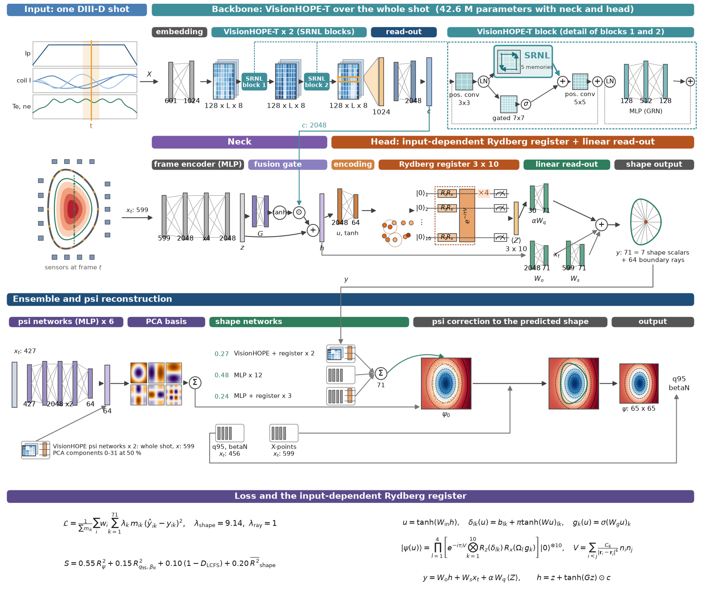

# Fusion Equilibrium Challenge 2026 — DIII-D entry (F20K)

Per EFIT frame: ψ(R, Z) 65×65, q95 and βN from coil currents, Ip and Thomson scattering only.
Hybrid classical + quantum: a VisionHOPE-T backbone over the whole shot, a zero-init gate into the frame's MLP trunk, and a
simulated 30-atom Rydberg register whose detunings and drives depend on each input - for the shape heads and, in F20K, for the
psi flux map itself (temporal psi networks on the leading PCA components).



<sub>Sizes are read from the trained checkpoints by [`repro/fusion/fig_model.py`](repro/fusion/fig_model.py).</sub>

## Results

| | Development public S | Paired gain on 150 held-out shots (vs the previous row) |
|---|---|---|
| F17K | 0.996223 | — |
| F18K | 0.996278 | +0.000084 [+0.000036, +0.000134] |
| **F20K** (Final) | (Final phase only) | **+0.000093 [+0.000017, +0.000187] vs F18K** |

## Run

```bash
uv venv .venv && uv pip install --python .venv/bin/python -r repro/fusion/requirements.lock      # VisionHOPE kernels need nvcc + ninja
uv venv -p 3.12 .venv-tdc && uv pip install --python .venv-tdc/bin/python catboost==1.2.10 numpy==2.5.2
hf download Sophelio/fusion-equilibrium-challenge --repo-type dataset --local-dir data/sophelio/fusion-equilibrium-challenge
.venv/bin/python repro/fusion/fetch_weights.py --base https://github.com/MuhammadHakami/fusion-equilibrium/releases/download/f20k-weights

QW_FOLD=diii_d_private_test runs/final_fold.sh                       # inputs-only feature blocks
QW_FOLD=diii_d_private_test CAND=F20K repro/fusion/infer.sh F20      # -> runs/sophelio_sota/submission_F20K/diii_d_private_test.npz

CAND=F20K repro/fusion/train_all.sh                                  # retrain everything (~19 A100-hours, estimated)
```

Data step, components, compute and provenance: [`repro/fusion/README.md`](repro/fusion/README.md).
Selection: shot-level stratified CV on the training shots, with Optuna, NAS, and Lean 4 proofs of the blend and gate rules ([`formal/`](formal/)).
MIT licence; `baseline/VisionHOPE` and `baseline/sophelio-starter` are MIT-licensed third-party code. AI coding assistants
(Claude Code) were used under the entrant's direction.
