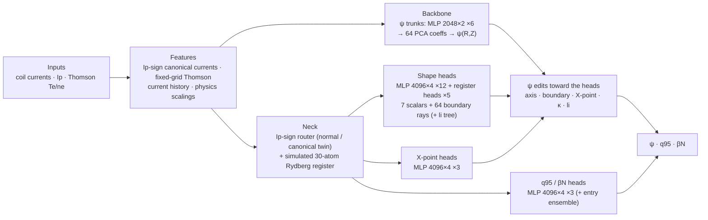

# Fusion Equilibrium Challenge 2026 — DIII-D entry (F17K)

Predicts the 65×65 flux map ψ, q95 and βN for every EFIT frame from coil currents, Ip and Thomson scattering only.



## Run

```bash
# 1 environment
uv venv .venv && uv pip install --python .venv/bin/python -r repro/fusion/requirements.lock
uv venv -p 3.12 .venv-tdc && uv pip install --python .venv-tdc/bin/python catboost==1.2.10 numpy==2.5.2

# 2 data (challenge dataset) + caches: step 1 of repro/fusion/README.md
hf download Sophelio/fusion-equilibrium-challenge --repo-type dataset --local-dir data/sophelio/fusion-equilibrium-challenge

# 3 weights (release assets, sha256-checked)
.venv/bin/python repro/fusion/fetch_weights.py --base https://github.com/MuhammadHakami/fusion-equilibrium/releases/download/f17k-weights

# 4 inference -> runs/sophelio_sota/submission_F17K/diii_d_private_test.npz
QW_FOLD=diii_d_private_test runs/final_fold.sh
QW_FOLD=diii_d_private_test CAND=F17K repro/fusion/infer.sh F17

# or train every model from scratch (~20 A100-hours, estimated)
CAND=F17K repro/fusion/train_all.sh
```

Details (components, compute, data provenance): [`repro/fusion/README.md`](repro/fusion/README.md).
MIT licence; `baseline/sophelio-starter/` is the organizers' MIT-licensed starter kit.
